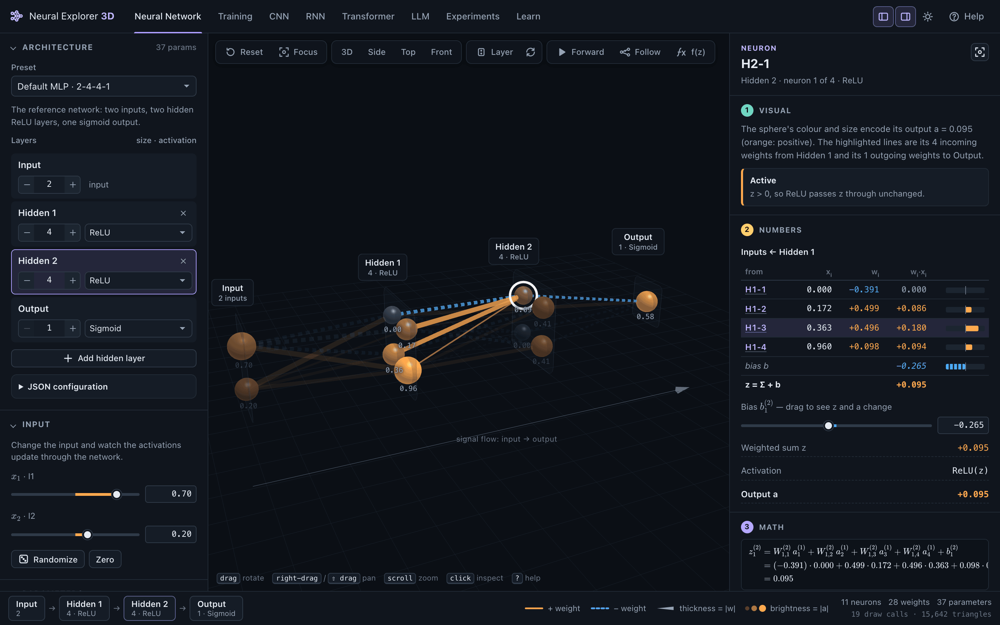
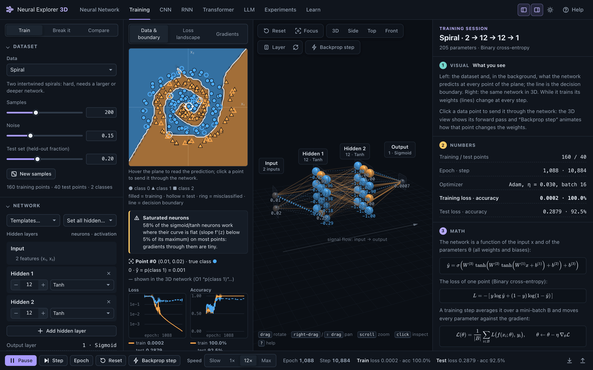
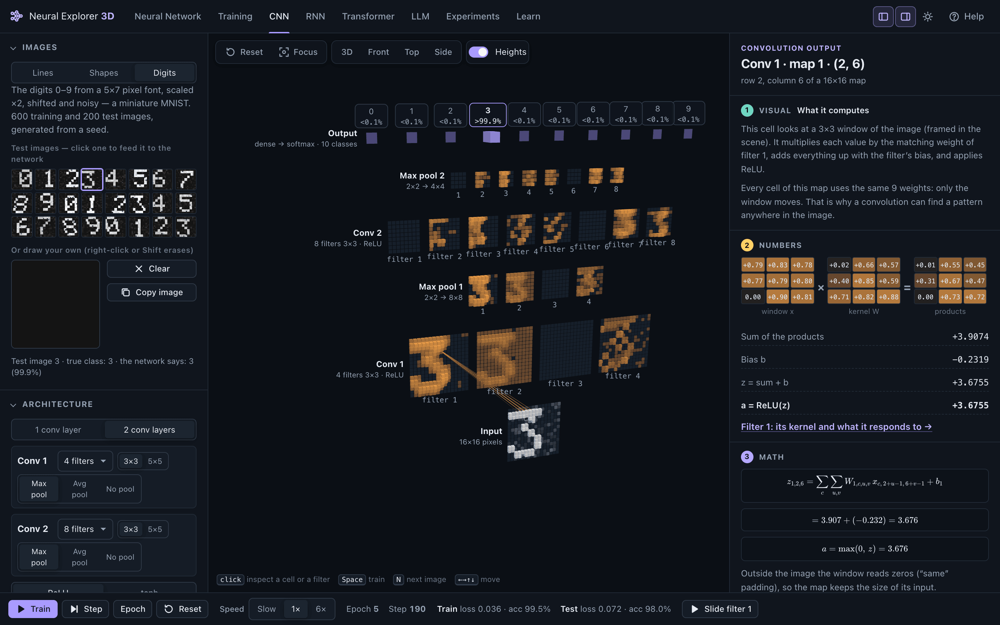
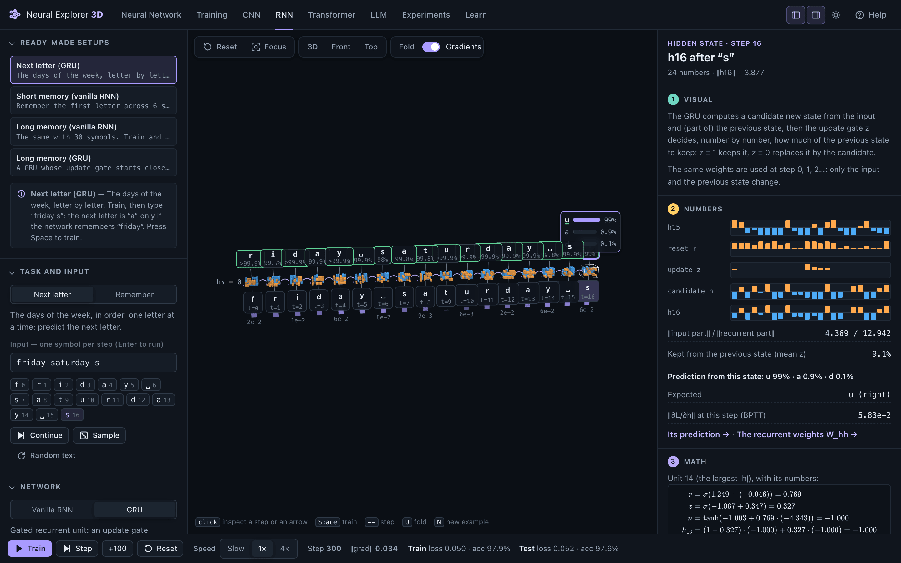
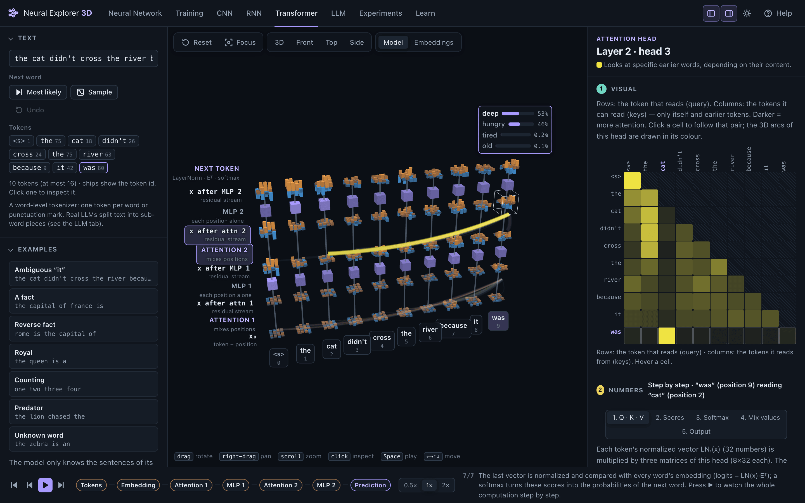
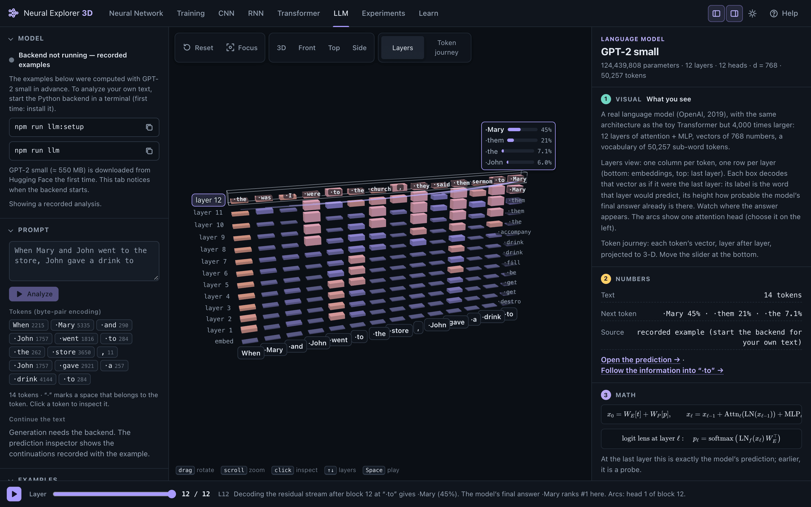
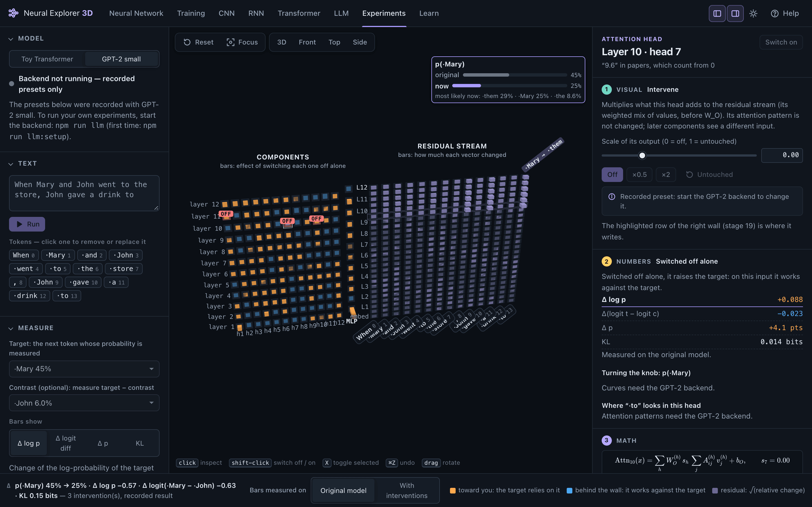
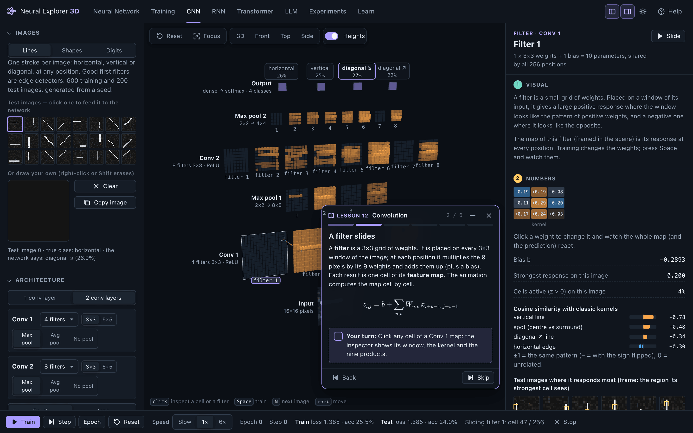

<h1 align="center">Neural Explorer 3D</h1>

<p align="center">
  <strong>See how neural networks work — from a single neuron to GPT-2 — in an interactive 3D scene where every number is real.</strong>
</p>

<p align="center">
  <a href="#quick-start">Quick start</a> ·
  <a href="#a-tour">Tour</a> ·
  <a href="#learn-13-guided-lessons">Lessons</a> ·
  <a href="#how-it-is-verified">How it is verified</a> ·
  <a href="docs/ARCHITECTURE.md">Architecture</a>
</p>

<p align="center">
  
  
  
  
  <a href="LICENSE"></a>
</p>



Neural Explorer 3D is an educational web app. You build, train and take apart real models — a multilayer
perceptron, a convolutional network, a recurrent network, a small Transformer and GPT-2 — and walk through
them in 3D. Click any neuron, weight, feature map, token or attention head and the inspector explains it on
**three levels**:

1. **Visual** — what you are looking at and how to read it;
2. **Numbers** — the actual values in the model right now;
3. **Math** — the formula, with those numbers substituted.

Nothing is animated just for show. The small networks and the Transformer run in your browser and match
PyTorch; GPT-2 runs in an optional local Python backend, or is shown from recordings when the backend is off.

## What's inside

| Tab | What you do there |
| --- | --- |
| **Neural Network** | Build a feed-forward network, drag weights, biases and inputs, watch the forward pass layer by layer. |
| **Training** | Train it live on 2-D data: loss, backpropagation in 3D, gradients, decision boundary, loss landscape — plus *Break it* (classic mistakes and their fixes) and *Compare* (two networks side by side). |
| **CNN** | A small convolutional network that learns images in seconds — including your own drawings — with every feature map, filter and pooling step visible. |
| **RNN** | A vanilla RNN or a GRU reading sequences step by step: the hidden state as memory, backpropagation through time, and why long memories are hard. |
| **Transformer** | A tiny GPT-style model computed step by step: tokens, embeddings, self-attention with Q/K/V, the residual stream, the MLP, the next token. |
| **LLM** | GPT-2 small: real tokens, next-token probabilities, the prediction forming layer by layer, attention heads, text generation. |
| **Experiments** | Switch off or modify parts of a model — heads, neurons, tokens, weights — and measure what changes. |
| **Learn** | 13 guided lessons that drive the scenes above and give you small tasks. |

## Quick start

Requirements: [Node.js](https://nodejs.org/) 20.19+ (or 22.12+) with npm, and a desktop browser with WebGL 2.
Clone the repository, then:

```bash
npm install
npm run dev
```

Open **http://localhost:5173**. Every tab works right away; the LLM and Experiments tabs show recorded GPT-2
results until you start the [optional backend](#optional-run-gpt-2-locally).

Drag to rotate, right-drag to pan, scroll to zoom, click to inspect. Press **?** for the controls and
shortcuts of the current tab, **T** to switch between the dark and the light theme, **[** and **]** to hide
or show the side panels.

### Optional: run GPT-2 locally

Needs Python 3.10+. The first command creates `python/.venv` (reusing PyTorch if it is already installed on
the system) and installs `transformers`, FastAPI and uvicorn; GPT-2 small (≈ 550 MB) is downloaded from
Hugging Face into `~/.cache/huggingface` the first time the backend starts.

```bash
npm run llm:setup
npm run llm
```

Keep it running in its own terminal: within a few seconds the LLM and Experiments tabs switch from recordings
to live computation — your own prompts, text generation, any intervention. Stop it with Ctrl+C.

### Commands

| Command | What it does |
| --- | --- |
| `npm run dev` | development server with hot reload (proxies `/api` to the Python backend) |
| `npm run build` | type check + static build in `dist/` |
| `npm run preview` | serves the build in `dist/` (also with the `/api` proxy) |
| `npm test` | unit tests (math, models, training, CNN, RNN, Transformer, experiments, lessons) — in Node, no browser |
| `npm run check` | TypeScript type check only |
| `npm run test:parity` | compares the browser's MLPs, training steps, CNN and RNN / GRU with **PyTorch** (needs `python3` with `torch`; skipped otherwise) |
| `npm run llm:setup` | creates `python/.venv` for the GPT-2 backend |
| `npm run llm` | starts the GPT-2 backend on http://127.0.0.1:8000 |
| `npm run llm:demos` | re-records the GPT-2 examples and experiment presets in `public/llm-demo/` |

`npm run build` produces a static site that works from any web server or sub-folder (GitHub Pages included).
Without the backend, the LLM and Experiments tabs use the recordings.

## A tour

### Neural Network

*(screenshot at the top)* Layers run left to right; neurons are spheres, weights are lines (thickness ∝ |w|,
colour = sign, negative weights also dashed). Click a neuron to see its inputs, weights, contributions, bias,
weighted sum, activation and output, with the formula filled in; drag any slider and the whole network
recomputes. *Forward* animates the computation layer by layer; *Follow* highlights where a value comes from
and where it goes; *f(z)* opens an explorer of the activation functions and their derivatives. Presets go
from a single neuron to an MNIST-sized 784-32-16-10 classifier, and any architecture can be written as
[JSON](#network-configuration).

### Training



Pick a dataset (XOR, AND, OR, circles, two moons, spiral, three blobs…), an architecture and an optimizer
(SGD, Momentum, Adam) and press Space. The 2-D plot shows the data and the decision boundary; the 3D network
shows the gradients on its connections; *Backprop step* animates one training step on one point — forward
pass, loss, the error δ flowing backwards, the update. The loss landscape is a 2-D slice of parameter space,
and is labelled as such. *Break it* stages eight classic failures — learning rate too large or too small,
zero or huge initial weights, vanishing gradients, dead ReLUs, underfitting, overfitting — each with its fix;
*Compare* trains two networks side by side on the same data.

### CNN



The input image sits at the bottom; above it, one row per step: the feature maps of each convolution (one per
filter), the same maps after pooling, and the class probabilities on top. Click a cell to see the window it
reads, the kernel and the nine products adding up to its value; click a filter to edit its kernel, compare it
with classic edge and line kernels and see the test images that excite it most; *Slide* animates the kernel
moving over its input. The images are synthetic 16×16 lines, shapes or digits — or your own drawing — and
training takes seconds: the digits reach about 98% test accuracy within a few epochs. The parameter count
shows what weight sharing saves compared with a fully connected layer.

### RNN



Time runs left to right: the symbol read at each step, the hidden state (a tile of bars), the prediction.
Every column uses the same weights, and *Fold* turns the drawing back into one cell with a loop. *Next letter*
learns the days of the week — after “friday saturday s” the right answer “u” needs memory of the previous
word; *Remember* asks for a letter seen 1–40 steps earlier. The bars under the inputs show ‖∂L/∂hₜ‖ from
backpropagation through time: over a 30-step gap a vanilla RNN's gradient shrinks by many orders of
magnitude, while a GRU whose update gate starts biased towards keeping its state carries it across and
learns the task. Both cells compute exactly what `torch.nn.RNN` and `torch.nn.GRU` compute.

### Transformer



A GPT-style model with 2 layers, 4 heads and d = 32 (about 28,600 parameters), trained in PyTorch on a tiny
corpus of templated sentences (capitals, animals, royals, counting…) and computed in your browser. Each
token's vector is a tile of 32 bars that changes layer after layer (the residual stream); arcs show
attention, one colour per head. Play the pipeline step by step, open a head to walk through
softmax(QKᵀ/√d)·V with the real numbers, or switch to the embedding space. Its forward pass matches the
PyTorch reference to 8 decimal places.

### LLM



GPT-2 small (124 M parameters) with its real byte-pair tokens. The logit-lens tower decodes every layer as if
it were the last; box height shows how probable the final answer already is there. Inspect tokens, heads,
layers and the prediction, and follow a token's vector through the layers (*Token journey*, a PCA
projection). With the backend running you can analyze any prompt and generate text with temperature, top-k
and top-p; without it, the tab shows seven recorded prompts.

### Experiments



Controlled interventions on the toy Transformer or on GPT-2: switch off or scale attention heads and MLP
layers, zero / scale / set single neurons, replace or remove tokens, edit weight matrices (toy model) — and
measure what changes: Δ log p, Δ logit difference against a contrast token, Δ p or KL divergence. The left
wall has one tile per head and per MLP layer, with a bar showing what switching that component off alone
would do; the right wall shows how much every token's residual stream changed, step by step — the change
starts where you intervene and only reaches later layers and later positions. Neuron scans compare a
first-order estimate (gradient × activation) with the measured effect. Ready-made experiments reproduce known
results, with the head numbers of the papers they come from: above, switching off GPT-2's three *name mover*
heads ([Wang et al., 2022](#references)) lowers p(“Mary”) from 45% to 25%. Experiments are saved and loaded
as JSON.

### Learn



Each lesson is a short sequence of steps: a card over the 3D view tells you what to look at, the scene is set
up for you, and small tasks (*make the weight negative*, *click a cell of a Conv 1 map*, *train until the loss
falls*) are checked against the real state of the model.

## Learn: 13 guided lessons

| # | Lesson | What it covers |
| --- | --- | --- |
| 1 | What is a neuron? | One neuron, two inputs: weights, bias and an activation function |
| 2 | Weighted sum | Contributions, active and inactive neurons, a layer as a matrix times a vector |
| 3 | Activation functions | ReLU, tanh, sigmoid and softmax — and why a network without them is a single weighted sum |
| 4 | Forward propagation | The signal from input to output, and where an output comes from |
| 5 | Loss | How wrong the network is: one number per point, averaged over the data |
| 6 | Backpropagation | One training step animated on one point, with the chain rule |
| 7 | Gradient descent | The learning rate, the loss landscape, steps that are too big |
| 8 | Embeddings | Words as vectors, and what a 3-D projection hides |
| 9 | Self-attention | Queries, keys, values, the causal mask — and what arcs do not prove |
| 10 | The Transformer | Attention and MLP blocks adding up in the residual stream, then an experiment to test it |
| 11 | Next-token prediction | From the last vector to probabilities, temperature — and a real model, GPT-2 |
| 12 | Convolution | Sliding filters, weight sharing, pooling, filters that learn to detect lines |
| 13 | Recurrence | A hidden state as memory, backpropagation through time, gates |

Open them with the **Learn** tab; your progress is remembered in the browser.

## How it is verified

Everything on screen is computed by the models, so the models have to be right:

- **Unit tests** (`npm test`): activations and their derivatives, forward passes, backpropagation checked
  against finite differences, optimizers, the CNN and RNN engines, the Transformer, the experiments engine and
  the lessons — 126 tests, run in Node.
- **PyTorch parity** (`npm run test:parity`): the browser's networks are rebuilt in PyTorch in float64 and
  compared — every MLP preset and activation, training steps with SGD, Momentum and Adam against
  `torch.optim`, the CNN (`nn.Conv2d`, max and average pooling) and the RNN / GRU (`nn.RNN`, `nn.GRU`),
  outputs and every gradient. The largest differences are around 10⁻¹⁶, i.e. rounding.
- **The toy Transformer** is trained in PyTorch and exported with reference outputs; the browser reproduces
  its logits to 8 decimal places.
- **GPT-2** is the real model, loaded with Hugging Face `transformers`; interventions are PyTorch forward
  hooks, and the recorded presets were produced by the same code.

### Reading the visuals honestly

- Sizes, colours and positions are chosen for readability; the inspector always shows the exact values and
  the formula that produced them. Sign is never encoded by colour alone (dashes, up / down, in front of /
  behind a wall).
- The Neural Network tab starts with random weights: its outputs are computed exactly but mean nothing until
  the network is trained.
- PCA projections (embedding space, token journey, loss landscape) keep only part of the variance, which is
  stated on the axes. The logit lens decodes layers that were never trained to be decoded. Attention weights
  show where information *can* flow, not why a prediction is made. Rollout and gradient × input are
  heuristics. Each inspector says so next to the numbers.
- Interventions measure effects on one input; switching a component off is a strong, unnatural change; the
  effects of several components do not simply add up. A large effect shows that the computation passes
  through a component, not what it “means”.

## Network configuration

The Neural Network tab is always generated from a configuration. Paste one into
**Architecture → JSON configuration** (or press Ctrl/⌘ + Enter there) and the network rebuilds itself;
errors show the path of the field, and the scene does not change until the configuration is valid.

```json
{
  "layers": [
    { "type": "input", "size": 3 },
    { "type": "dense", "size": 5, "activation": "relu" },
    { "type": "dense", "size": 4, "activation": "relu" },
    { "type": "output", "size": 2, "activation": "softmax" }
  ]
}
```

<details>
<summary>All fields, limits and file formats</summary>

| Field | Where | Meaning |
| --- | --- | --- |
| `name`, `description` | network | optional |
| `type` | layer | `input` (first only), `dense`, `output` (last only) |
| `size` | layer | number of neurons (1–1024) |
| `activation` | dense / output | `linear`, `relu`, `leaky_relu`, `sigmoid`, `tanh`, `gelu`, `softmax` (output only). Default: `relu` for hidden layers, `linear` for the output |
| `name` | layer | display name (default "Input", "Hidden 1", …, "Output") |
| `labels` | layer | neuron labels, e.g. `["cat", "dog"]` |
| `shape` | input | 2-D arrangement, e.g. `[28, 28]` (rows × columns = size) |
| `range` | input | range of the input sliders, default `[-1, 1]` |

Limits (to stay smooth on modest hardware): 16 layers, 4,096 neurons, 120,000 connections. Conventions match
PyTorch: a `dense` layer is `nn.Linear(in, out)` + activation, GELU is the exact (erf) version, Leaky ReLU
uses slope 0.01.

*Parameters → Export* saves a `*.model.json` file (architecture, weights in the `nn.Linear.weight` shape
`[out, in]`, the input and the output computed in the browser); *Import* accepts a model file or a bare
configuration. `python/mlp_bridge.py` turns such a file into a PyTorch `nn.Sequential` and back. Training
sessions and experiments have their own JSON files too.

</details>

## Python and PyTorch

Python is optional and used for three things (details in [`python/README.md`](python/README.md)):

- **Parity checks** — `python/mlp_bridge.py` and `python/cnn_rnn_bridge.py` rebuild the browser's networks
  in PyTorch and compare outputs and gradients (`npm run test:parity` runs them).
- **The toy Transformer** — `python/toy_transformer/train.py` trains it and exports the weights, together
  with the reference outputs that the TypeScript implementation must reproduce.
- **The GPT-2 backend** — `python/server` (FastAPI): analyses, generation and experiments with forward
  hooks, used by the LLM and Experiments tabs.

## Project structure

```
├── index.html
├── src/
│   ├── main.ts                 entry point
│   ├── app/                    composition root, shell, UI state, help, workspace contract
│   ├── core/                   Emitter, Store, DisposeBag
│   ├── math/                   activations (+ derivatives + TeX), linear algebra, PCA, seeded RNG, stats
│   ├── neural/                 MLP model: configuration, topology, forward pass, init, files, presets
│   ├── training/               datasets, losses, backpropagation, optimizers, trainer, scenarios, landscape
│   ├── cnn/                    convolutional network: image datasets, model, forward / backward, trainer, analyses
│   ├── rnn/                    vanilla RNN and GRU: tasks, model, BPTT, trainer
│   ├── transformer/            toy Transformer: model, tokenizer, forward pass with full trace, sampling, analyses
│   ├── llm/                    client of the GPT-2 backend and loader of the recordings
│   ├── experiments/            experiments as data: toy engine, GPT-2 engine, metrics, presets, files
│   ├── lessons/                the 13 lessons, the lesson player and catalog
│   ├── visualization/          3D layout, visual encodings, emphasis, palettes (no three.js, no DOM)
│   ├── three/                  viewport, camera and one view per tab
│   ├── animation/              central animation controller
│   ├── ui/                     DOM helper, widgets, KaTeX, overlays, charts, inspector host
│   ├── workspaces/             one folder per tab: panels, inspectors, bars, toolbars
│   └── styles/main.css         design tokens, dark and light themes
├── public/
│   ├── models/                 weights of the toy Transformer (+ reference outputs)
│   └── llm-demo/               recorded GPT-2 analyses and experiments
├── python/                     PyTorch bridges, toy Transformer training, GPT-2 backend
├── tests/                      PyTorch parity tests
└── docs/ARCHITECTURE.md        architecture and design decisions
```

The math does not depend on the rendering: `src/math`, `src/neural`, `src/training`, `src/cnn`, `src/rnn`,
`src/transformer`, `src/experiments` and `src/visualization` import neither three.js nor the DOM and are
tested in Node. In the browser console, `neuralExplorer` gives access to the app and its models, e.g.
`neuralExplorer.model.setWeight(1, 0, 0, 0.5)`. The design decisions are recorded in
[`docs/ARCHITECTURE.md`](docs/ARCHITECTURE.md).

**Built with** TypeScript (strict, no UI framework), [three.js](https://threejs.org/) for WebGL,
[KaTeX](https://katex.org/) for the formulas, [Vite](https://vite.dev/) and [Vitest](https://vitest.dev/);
optionally [PyTorch](https://pytorch.org/), Hugging Face [Transformers](https://github.com/huggingface/transformers)
and [FastAPI](https://fastapi.tiangolo.com/).

**Browsers.** Developed and tested in desktop Chrome. Other recent desktop browsers with WebGL 2 should work
but have not been tested systematically; phones and tablets are not a target (the layout needs a wide screen
and a mouse).

## Roadmap

- An LSTM cell next to the GRU.
- Pythia models in the backend, next to GPT-2.
- Activation patching between two prompts, and mean ablation, in the Experiments tab.
- UMAP next to PCA for the embedding views.
- Tabs loaded on demand, for a smaller first download.

## References

The models, visualizations and ready-made experiments follow these works:

- Rumelhart, Hinton & Williams (1986). [Learning representations by back-propagating errors](https://doi.org/10.1038/323533a0). *Nature*.
- LeCun, Bottou, Bengio & Haffner (1998). [Gradient-based learning applied to document recognition](https://doi.org/10.1109/5.726791). *Proceedings of the IEEE*.
- Elman (1990). [Finding structure in time](https://doi.org/10.1207/s15516709cog1402_1). *Cognitive Science*.
- Bengio, Simard & Frasconi (1994). [Learning long-term dependencies with gradient descent is difficult](https://doi.org/10.1109/72.279181). *IEEE Transactions on Neural Networks*.
- Pascanu, Mikolov & Bengio (2013). [On the difficulty of training recurrent neural networks](https://arxiv.org/abs/1211.5063). *ICML*.
- Cho et al. (2014). [Learning phrase representations using RNN encoder–decoder for statistical machine translation](https://arxiv.org/abs/1406.1078). *EMNLP* — the GRU.
- Kingma & Ba (2015). [Adam: a method for stochastic optimization](https://arxiv.org/abs/1412.6980). *ICLR*.
- Li, Xu, Taylor, Studer & Goldstein (2018). [Visualizing the loss landscape of neural nets](https://arxiv.org/abs/1712.09913). *NeurIPS*.
- Vaswani et al. (2017). [Attention is all you need](https://arxiv.org/abs/1706.03762). *NeurIPS*.
- Radford et al. (2019). [Language models are unsupervised multitask learners](https://cdn.openai.com/better-language-models/language_models_are_unsupervised_multitask_learners.pdf). OpenAI — GPT-2.
- nostalgebraist (2020). [Interpreting GPT: the logit lens](https://www.lesswrong.com/posts/AcKRB8wDpdaN6v6ru/interpreting-gpt-the-logit-lens). *LessWrong*.
- Abnar & Zuidema (2020). [Quantifying attention flow in transformers](https://arxiv.org/abs/2005.00928). *ACL* — attention rollout.
- Olsson et al. (2022). [In-context learning and induction heads](https://arxiv.org/abs/2209.11895). *Transformer Circuits Thread*.
- Wang, Variengien, Conmy, Shlegeris & Steinhardt (2022). [Interpretability in the wild: a circuit for indirect object identification in GPT-2 small](https://arxiv.org/abs/2211.00593). *ICLR 2023*.
- Nanda (2023). [Attribution patching: activation patching at industrial scale](https://www.neelnanda.io/mechanistic-interpretability/attribution-patching).

## License

Released under the [MIT License](LICENSE).
